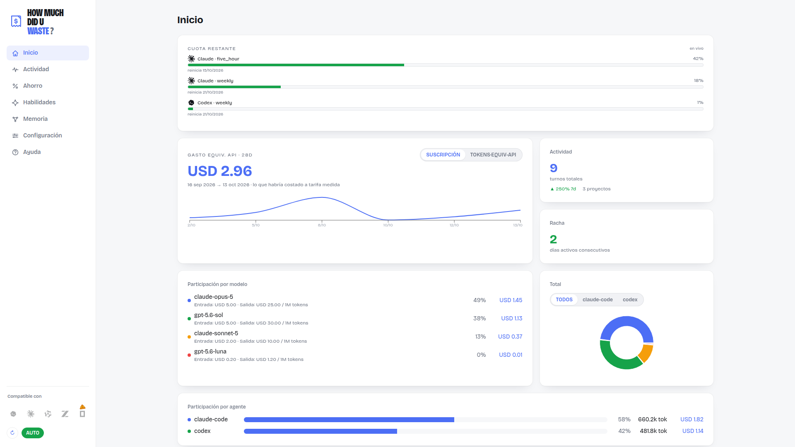
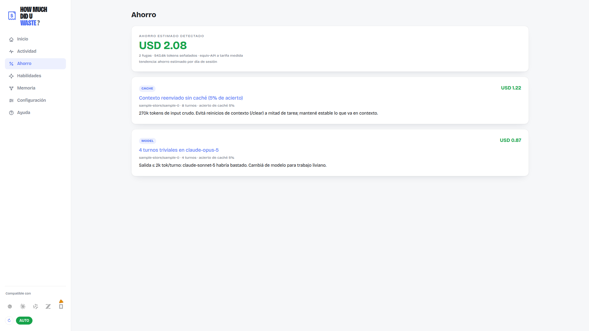
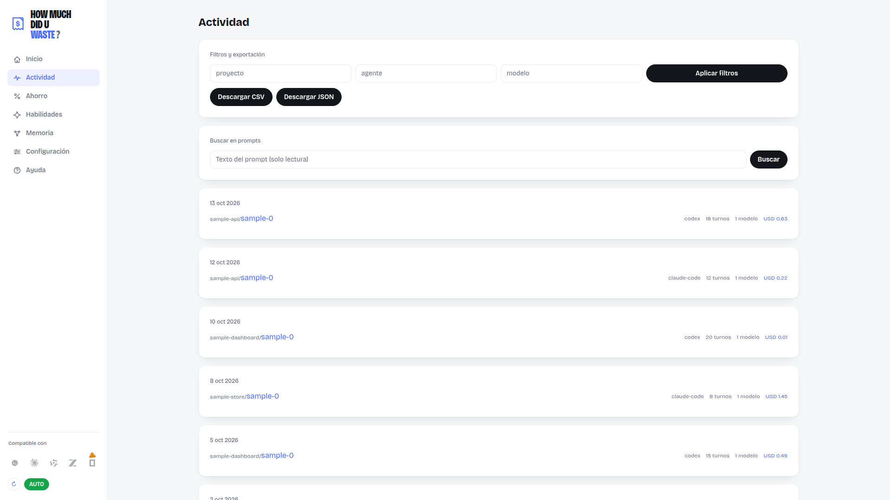
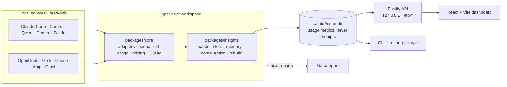

# How much did u waste? · v0.0.7-beta

[](https://github.com/Adudu02/How-much-did-U-waste/actions/workflows/ci.yml)

A local-first cost and activity dashboard for coding agents. It reads supported
agent transcripts and local usage databases in **read-only** mode, computes
API-equivalent spend, and helps identify token waste. The dashboard includes
per-model prices, quota indicators, skill usage, memory, and Spanish and English
(US) interface languages.







Screenshots use synthetic sample data and contain no local activity records.

## Data and privacy

Agent transcript and source database files are **read-only**. File adapters open
sources for reading; SQLite adapters use the read-only snapshot helper. App-owned
state lives in `./data/`: metrics database, configuration, pricing overrides,
quota cache, and reports. Prompts are read from source transcripts only when
requested in Activity and are never persisted to the metrics database.

The server binds to `127.0.0.1:8081` and has no authentication. Quota and pricing
refresh features can contact their configured providers. Do not expose the
server to a LAN or public proxy.

## Architecture



File adapters incrementally ingest Claude Code, Codex, Qwen, Gemini, and Zcode.
Read-only SQLite or directory sync adapters support OpenCode, Grok, Goose, Amp,
and Crush. `packages/core` owns source adapters, normalized usage, cost
calculation, and storage. `packages/insights` adds waste analysis, skills,
memory, configuration, and orchestration. The Fastify API and CLI use these
workspace packages.

## Try it (no clone needed)

The package is not yet published to npm. Install from a GitHub release:

```bash
npx https://github.com/Adudu02/How-much-did-U-waste/releases/download/v0.0.7-beta/how-much-did-u-waste-0.0.7-beta.tgz
```

It serves the dashboard at `http://127.0.0.1:8081`. It reads detected local
sources and stores app state in `./data` under the directory where you run it.
For a terminal waste report, run `npx how-much-did-u-waste --waste`.

## Quick start (from the repo)

Requires **Node.js 22.13+** and **pnpm 11.18.0** (`corepack enable pnpm`).

```bash
pnpm install
pnpm start         # builds the UI if missing and serves http://127.0.0.1:8081
```

`pnpm start` installs/builds missing dependencies or UI assets before starting.
On Linux/macOS, `./start.sh` also opens the browser. After pulling new code, run
`./start.sh --update` (or `pnpm run update`) to reinstall, rebuild, and restart.

## Sources and dashboard

File-based sources: Claude Code, Codex, Qwen, Gemini, and Zcode. Local sync
sources: OpenCode, Grok, Goose, Amp, and Crush. The app detects their default
locations on startup. Configure supported paths in **Settings → Agent paths**,
then choose **Rebuild**. See **Help** in the dashboard for source details.

The pages are **Inicio** (activity summary, model participation and configured
input/output prices, quota), **Actividad** (filterable sessions and on-demand
prompt search), **Ahorro** (waste findings), **Skills**, **Memoria**,
**Configuración**, and **Ayuda**. The interface supports Spanish and English
(US); the selected language is saved in browser storage.

Rates are displayed in USD per million tokens. Unknown models remain visible
with zero estimated cost and an unpriced indicator; the app does not guess
missing rates. `data/pricing.json` supports local overrides.

## Commands

```bash
pnpm start          # install/build missing parts and serve the dashboard
pnpm cli            # print spend/model/day summary
pnpm cli -- --waste  # print token-waste findings
pnpm rebuild        # rebuild the local metrics database from detected sources
pnpm improve        # use the latest local report to propose repo improvements
pnpm serve          # API + production UI at http://127.0.0.1:8081
pnpm dev            # API + Vite dev server (port 5173)
pnpm build          # build workspace packages, UI, and app
pnpm test           # run workspace and app tests
pnpm lint           # Biome lint
pnpm typecheck      # TypeScript check
```

## API

`GET /api/summary` · `GET /api/skills` · `PUT /api/skills/:name/meta` ·
`DELETE /api/skills/:name` · `GET /api/memory` · `GET /api/activity` ·
`GET /api/activity/search` · `GET /api/export?format=csv|json` ·
`GET /api/waste` · `GET /api/session/:id` · `GET /api/session/:id/turns` ·
`GET|PUT /api/config` · `GET|PUT /api/pricing` · `GET /api/pricing-status` ·
`POST /api/pricing/refresh` · `GET /api/quota` · `POST /api/quota/refresh` ·
`POST /api/rebuild` · `POST /api/refresh` · `GET /api/health`.

`/api/activity` supports `limit` (max 100), `cursor`, `project`, `agent`, and
`model`. `/api/activity/search?q=text` searches source transcripts on demand;
results are not stored. `/api/export` includes sessions and usage events, not
prompts. After editing pricing, run a rebuild to recompute stored costs.

## Cost model

`data/pricing.json` stores configured rates. Per-event cost is:

```text
cost = input·input_rate + output·output_rate
     + cache_write·input_rate·1.25 + cache_read·input_rate·0.10
```

This is **API-equivalent** cost: an estimate at configured API rates, even when
the user pays for a subscription. Unknown model rates are not estimated.

## Workspace packages

- **`how-much-did-u-waste-core`** — adapters, incremental ingest, metrics-only
  SQLite, API-equivalent costing, and aggregate views.
- **`how-much-did-u-waste-insights`** — waste findings, skills catalog, memory
  graph, configuration, and rebuild orchestration.
- **`how-much-did-u-waste-report`** — CLI/reporting functionality.

Import public exports from each package barrel rather than internal routes.

## Changelog

See [`CHANGELOG.md`](CHANGELOG.md) for release-by-release changes.
